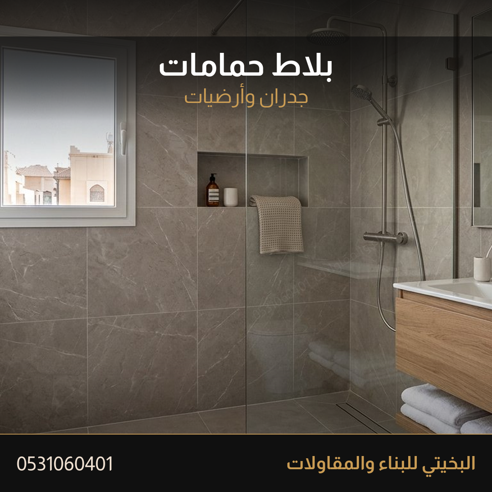
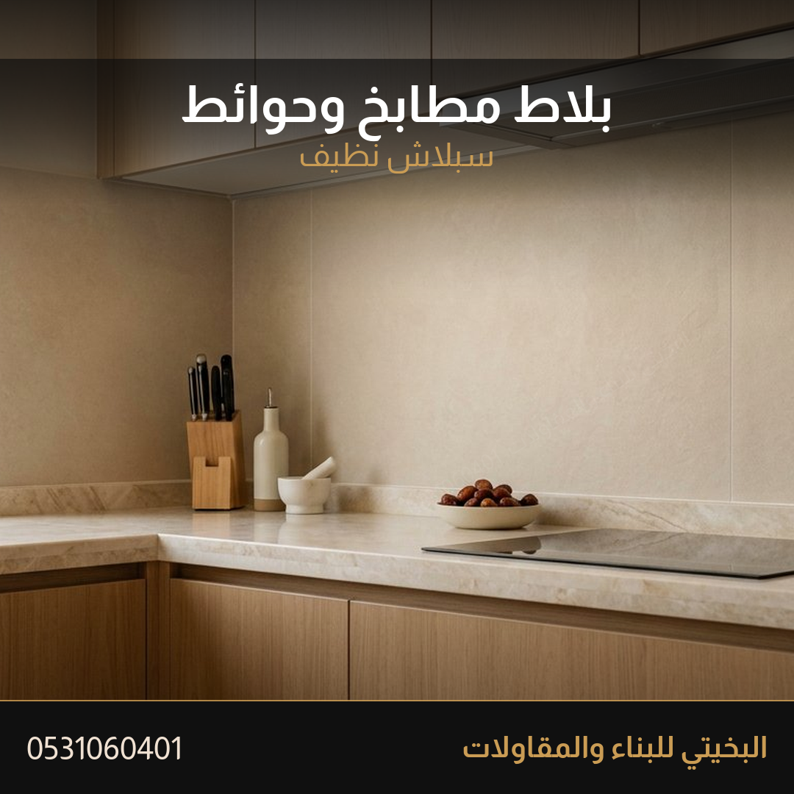
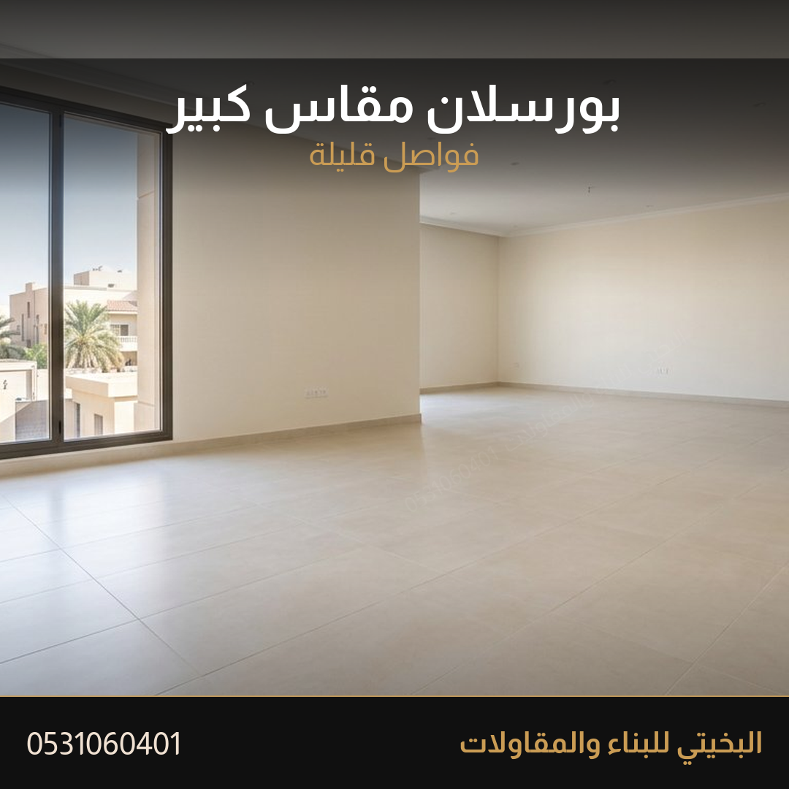
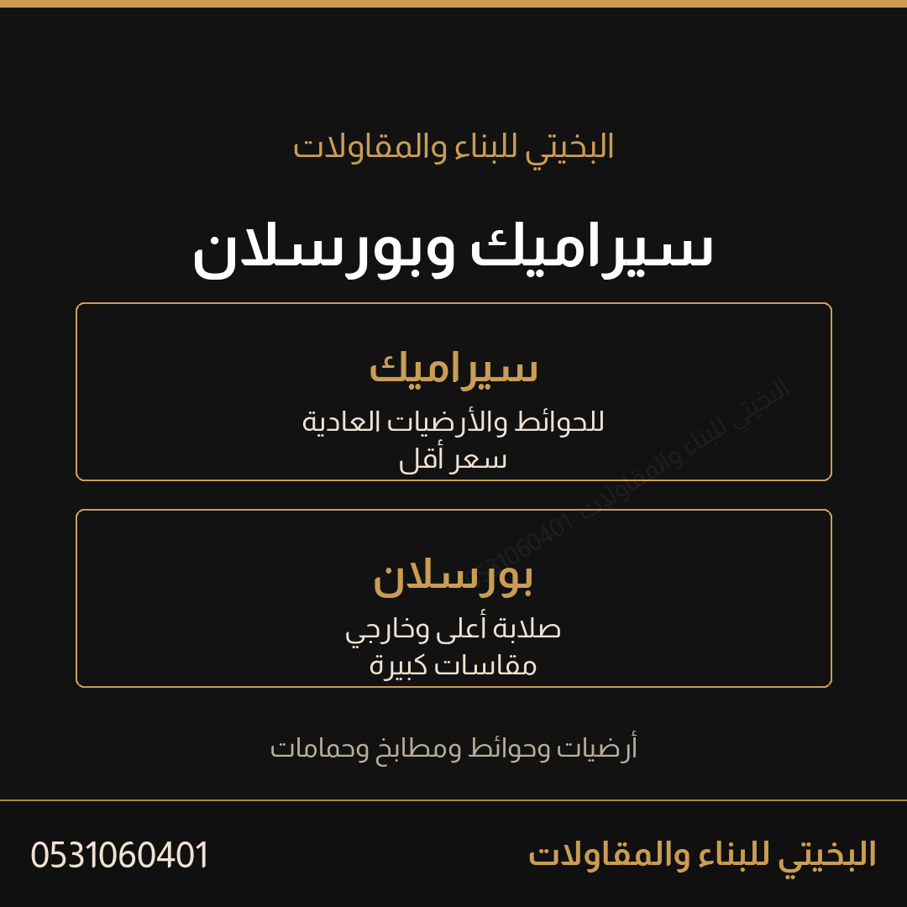

# إعلان البلاط والسيراميك

الإعلان الوحيد للبلاط. يغطي التوريد والتركيب وكل أنواع السيراميك والبورسلان والحوائط والمطابخ والحمامات والخارجي والانترلوك. لا يُنشر إعلان بلاط ثانٍ.

## نموذج العمل

العميل يوصف الشغل. أنت تقيس وتختار الصنف معه وتشتري من المورد وتركب وتضمن. أنت لست دلالاً يرسل العميل لمعرض، بل مقاول توريد وتركيب.

التفاصيل الكاملة في `العمليات/نموذج-توريد-وتركيب-البلاط.md`، وقائمة الموردين في `دراسات/موردي-البلاط-الرياض.md`.

## البحث قبل الكتابة

فحصت حراج عن «معلم بلاط» و«انترلوك» في 18 أكتوبر 2026:

- أغلب منافسي البلاط في جدة ومكة والمدينة، والرياض فيها جلي وتلميع رخام لا تركيب.
- المنافس يكتب سعر المتر في العنوان مثل 18 ريالاً بلا تفصيل خامة ولا ميول ولا تصريف.
- إعلانات الانترلوك معظمها بيع مواد وطبالي، والتركيب قليل.
- لا أحد يقدّم «توريد وتركيب بأنواع ومستويات» كخدمة واحدة.

الفراغ: الوضوح في الأنواع والتوريد والإشراف بدل المنافسة على السعر.

## العنوان

```
توريد وتركيب بلاط وسيراميك وبورسلان مطابخ وحمامات الرياض البخيتي
```

64 حرفاً.

## الوصف — انسخه كما هو

```
البخيتي للبناء والمقاولات
توريد وتركيب بلاط في الرياض
سيراميك وبورسلان لكل الأنواع
أرضيات وحوائط ومطابخ وحمامات
بلاط خارجي وانترلوك وبلدورات
أقيس المكان وأوريك ثلاثة مستويات
من اقتصادي إلى بورسلان كبير وبديل رخام
تختار أنت وأنا أشتري وأركب وأتابع
دفعة ألوان واحدة وكمية احتياط للقطع
أرسل صورة المكان والمقاس
أقولك السعر على شغلك وإذا اتفقنا أمشي على كلامنا
الأهم الثقة والأمانة
0531060401
الرياض
```

14 سطراً.

## كلمات آخر الإعلان

```
توريد بلاط الرياض، تركيب بلاط، معلم بلاط، سيراميك، بورسلان، بلاط حمامات، بلاط مطابخ، حوائط، بلاط خارجي، انترلوك، بلدورات، بديل رخام، البخيتي للبناء والمقاولات
```

13 كلمة.

## وصف الصفحة

```
توريد وتركيب بلاط وسيراميك وبورسلان في الرياض مطابخ وحمامات وحوائط وأرضيات وخارجي مع القياس والنقل والإشراف والضمان تنفيذ البخيتي
```

129 حرفاً.

## ترتيب الرفع

| الترتيب | الملف | لماذا |
|---|---|---|
| 1 | `صور/01-الحوش.png` | الغلاف. بلاط خارجي بميول وتصريف، وهو فراغ لا يغطيه أحد |
| 2 | `صور/06-الحمام.png` | الحمامات، وهي أكثر ما يُطلب |
| 3 | `صور/07-المطبخ.png` | المطابخ والحوائط |
| 4 | `صور/03-الداخلي.png` | الداخلي |
| 5 | `صور/08-البورسلان.png` | البورسلان الكبير |
| 6 | `صور/02-المدخل.png` | الانترلوك والمداخل |
| 7 | `صور/04-التفصيلة.png` | القطع حول الصرف |
| 8 | `صور/05-التجهيز.png` | العزل قبل البلاط |
| 9 | `صور/09-الأنواع.png` | بطاقة الفرق بين السيراميك والبورسلان |
| 10 | `صور/10-ستوري.png` | حالة واتساب |

## الرد داخل حراج

```
السلام عليكم
معك البخيتي للبناء والمقاولات
توريد وتركيب بلاط وسيراميك وبورسلان في الرياض
مطابخ وحمامات وأرضيات وحوائط وخارجي
أرسل صورة المكان والمقاس
أقولك السعر على شغلك
0531060401
```

## أول رد واتساب

```
أهلا
عشان السعر يكون دقيق
أرضية أو حوائط أو الاثنين
داخلي أو خارجي
المساحة وعدد الحمامات والمطابخ
وصورة المكان واللوكيشن
```

## أنواع نعرضها

الكتالوج الكامل في `الهوية/كتالوج-أنواع-البلاط.md`. الخلاصة:

| النوع | الاستخدام |
|---|---|
| سيراميك أرضيات | الصالات والغرف |
| سيراميك حوائط | الحمامات والمطابخ |
| بورسلان مطفي ولامع | المجالس والمداخل والصالات |
| بورسلان بديل الرخام | المداخل والمجالس |
| بلاط خارجي مقاوم انزلاق | الحوش والسطح |
| بلاط مسابح وموزايك | المسبح والحمامات |
| انترلوك وبلدورات | المداخل والأحواش |
| حواشي وأطواق | الحواف والدرج |

## ما لا يدخل هذا الإعلان

- لا سعر للمتر ولا سعر إجمالي.
- لا وعد بمدة.
- لا جلي ولا تلميع رخام.
- لا صورة من إعلان البلك أو الحجر.
- لا ذكر لماركة خامة ولا سعر مورد.
- لا اسم حي ولا اسم عميل.

## الصور

### 1 — الغلاف


`صور/01-الحوش.png`

### 2 — الحمام



`صور/06-الحمام.png`

### 3 — المطبخ



`صور/07-المطبخ.png`

### 4 — الداخلي


`صور/03-الداخلي.png`

### 5 — البورسلان الكبير



`صور/08-البورسلان.png`

### 6 — المدخل


`صور/02-المدخل.png`

### 7 — التفصيلة


`صور/04-التفصيلة.png`

### 8 — التجهيز


`صور/05-التجهيز.png`

### 9 — الأنواع



`صور/09-الأنواع.png`

### 10 — ستوري


`صور/10-ستوري.png`
