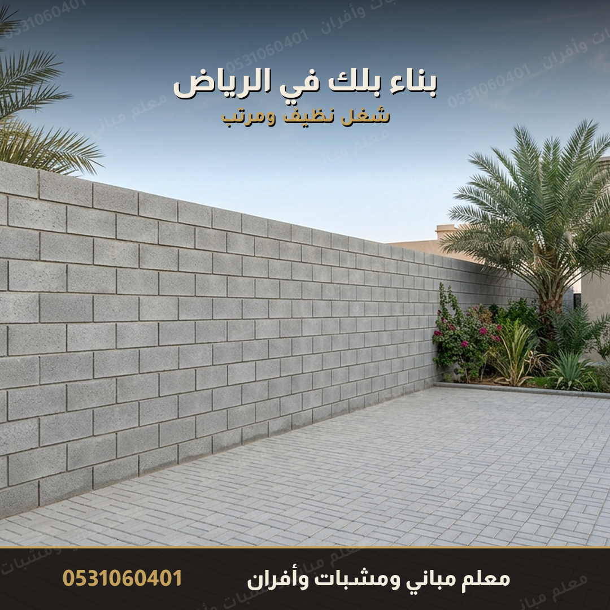
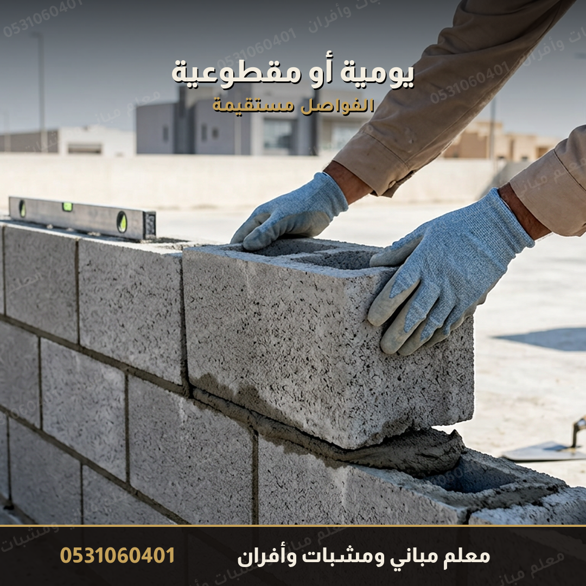
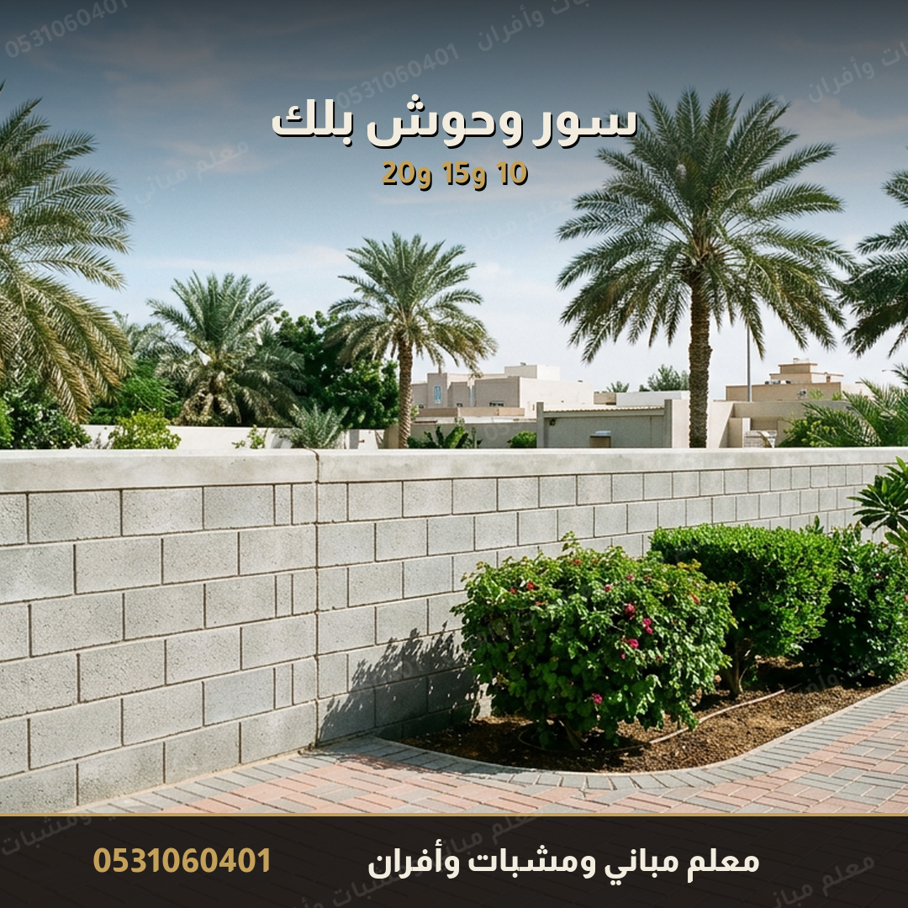
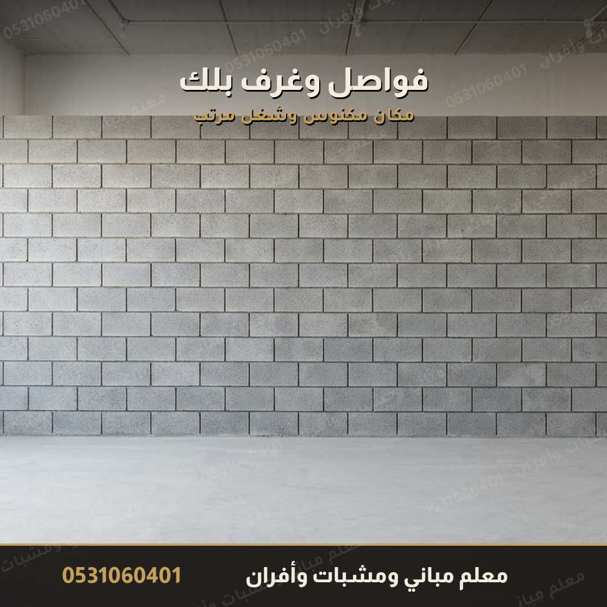
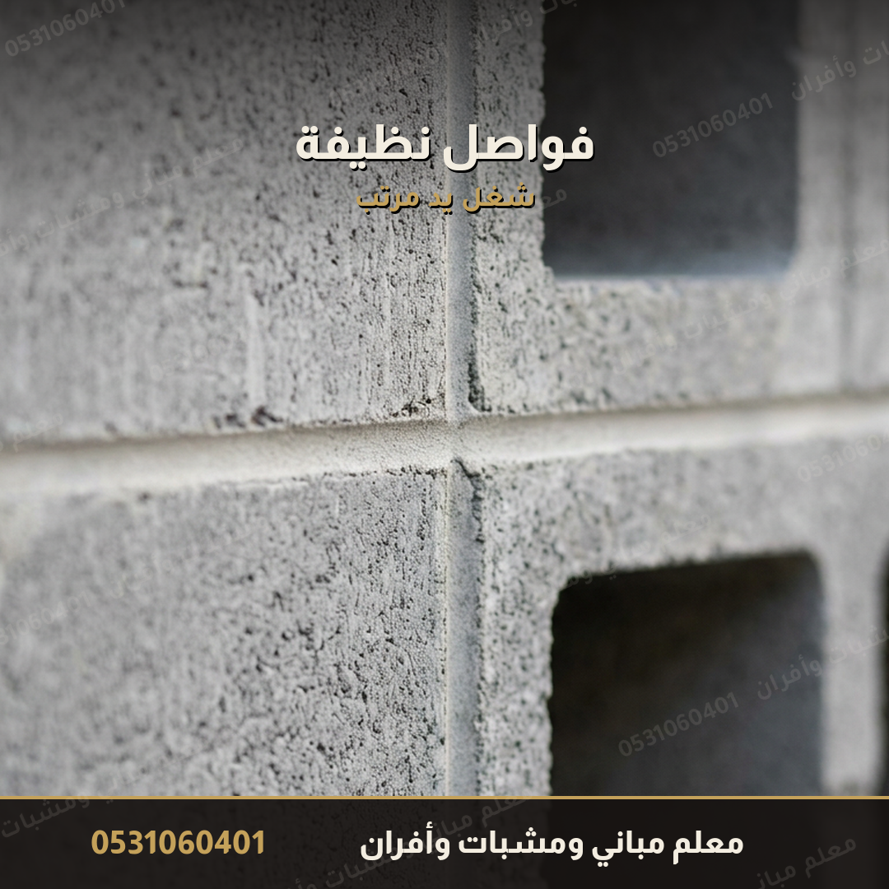
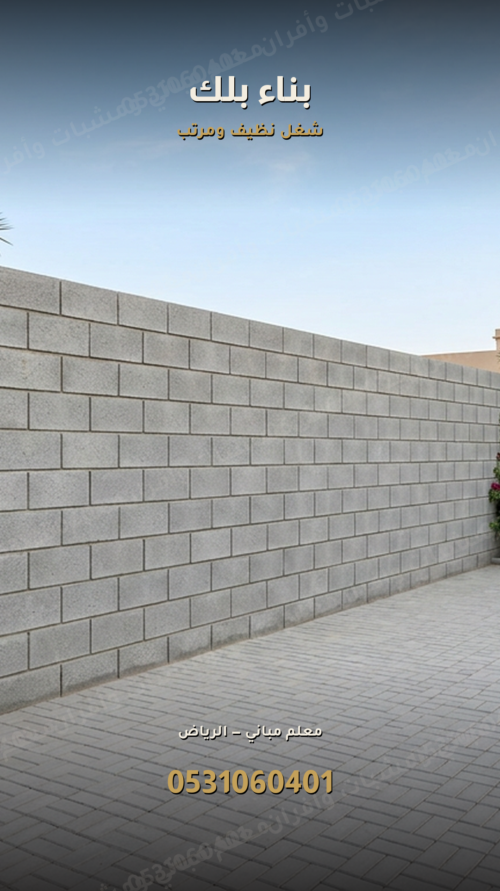

# إعلان بناء البلك

هذا الملف وحده يكفي لنشر إعلان البلك. الصور في المجلد `صور` بجانبه، ولا تُستخدم في إعلان المشبات أو غيره.

> [!info] كيف تنشره
> إعلان جديد في خدمات، الرياض. الصورة الأولى `01-الجدار.png`. التعليقات مفتوحة. لا تحذفه وتدمجه مع إعلان المشبات.

> [!warning] لا يُنشر
> لا تكتب كلمة «عرض» ولا «خصم». لا تنزل السعر إلى 15 ريال للمتر لمجاراة إعلانات حراج. السعر يُكتب بعد صورة المكان.

## العنوان

```
بناء بلك الرياض | يومية ومقطوعية | جدران وفواصل وسور
```

## الوصف — انسخه كما هو

```
بناء بلك في الرياض.
أشتغل بيدي، والشغل نظيف ومرتب.

يومية، أو مقطوعية:
▪️ جدران بلك
▪️ فواصل وغرف
▪️ سور وحوش
▪️ مقاس 10 و15 و20، حسب شغلك

اليومية: أجرة اليوم نتفق عليها من البداية، والمواد منك إلا إذا اتفقنا غير كذا.
المقطوعية: سعر المتر أو سعر الشغلة يُكتب من البداية، وما يتغير.

أرسل نوع البلك، والطول والارتفاع، وصورة المكان.
📱 0531060401
الرياض
```

## كلمات آخر الإعلان

```
بناء بلك الرياض، بناء بلوك، معلم بلك، يومية بلك، مقطوعية بلك، جدران بلك، فواصل بلك، سور بلك، بلك 10، بلك 15، بلك 20، البخيتي للبناء والمقاولات
```

## ترتيب الرفع

| الترتيب | الملف | لماذا |
|---|---|---|
| 1 | `صور/01-الجدار.png` | غلاف الإعلان. سور نظيف وأرض مبلطة |
| 2 | `صور/02-اليومية.png` | اليد وهي تضبط البلك بالميزان |
| 3 | `صور/03-السور.png` | سور وحوش مرتب |
| 4 | `صور/04-الفواصل.png` | فاصل داخلي نظيف |
| 5 | `صور/05-يومية-ومقطوعية.png` | الفرق بين اليومية والمقطوعية |
| 6 | `صور/06-التفصيلة.png` | الفاصل المستقيم من قرب |
| حالة | `صور/07-ستوري.png` | حالة واتساب، ليست صورة الإعلان الأولى |

## الرد داخل حراج

```
السلام عليكم
نبني بلك في الرياض: جدران، فواصل، وسور.
يومية أو مقطوعية، والسعر على مكانك.
أرسل نوع البلك والطول والارتفاع وصورة.
واتساب: 0531060401
```

## أول رد واتساب

```
أهلاً
عشان السعر يكون على شغلك:
1) يومية أو مقطوعية؟
2) بلك 10 أو 15 أو 20؟
3) الطول والارتفاع التقريبي؟
4) صورة المكان واللوكيشن؟
المواد في اليومية تكون منك، إلا إذا اتفقنا غير كذا.
```

## ما لا يدخل هذا الإعلان

- لا فلل ولا عمائر.
- إذا الشغل يحتاج عاملاً، يُوضَّح قبل الاتفاق.
- شروط الدفع تبقى على الخاص، وليست في الصورة ولا في الوصف.
- لا صورة من إعلان المشبات أو الأفران.

## الصور

### 1 — غلاف الإعلان



`صور/01-الجدار.png`

### 2 — يومية أو مقطوعية



`صور/02-اليومية.png`

### 3 — سور وحوش



`صور/03-السور.png`

### 4 — فواصل وغرف



`صور/04-الفواصل.png`

### 5 — الفرق بين اليومية والمقطوعية


`صور/05-يومية-ومقطوعية.png`

### 6 — تفصيلة الفاصل



`صور/06-التفصيلة.png`

### حالة واتساب



`صور/07-ستوري.png`

