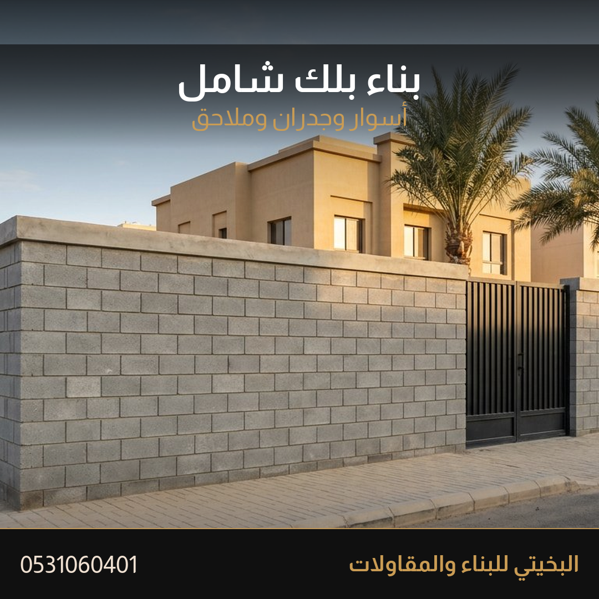
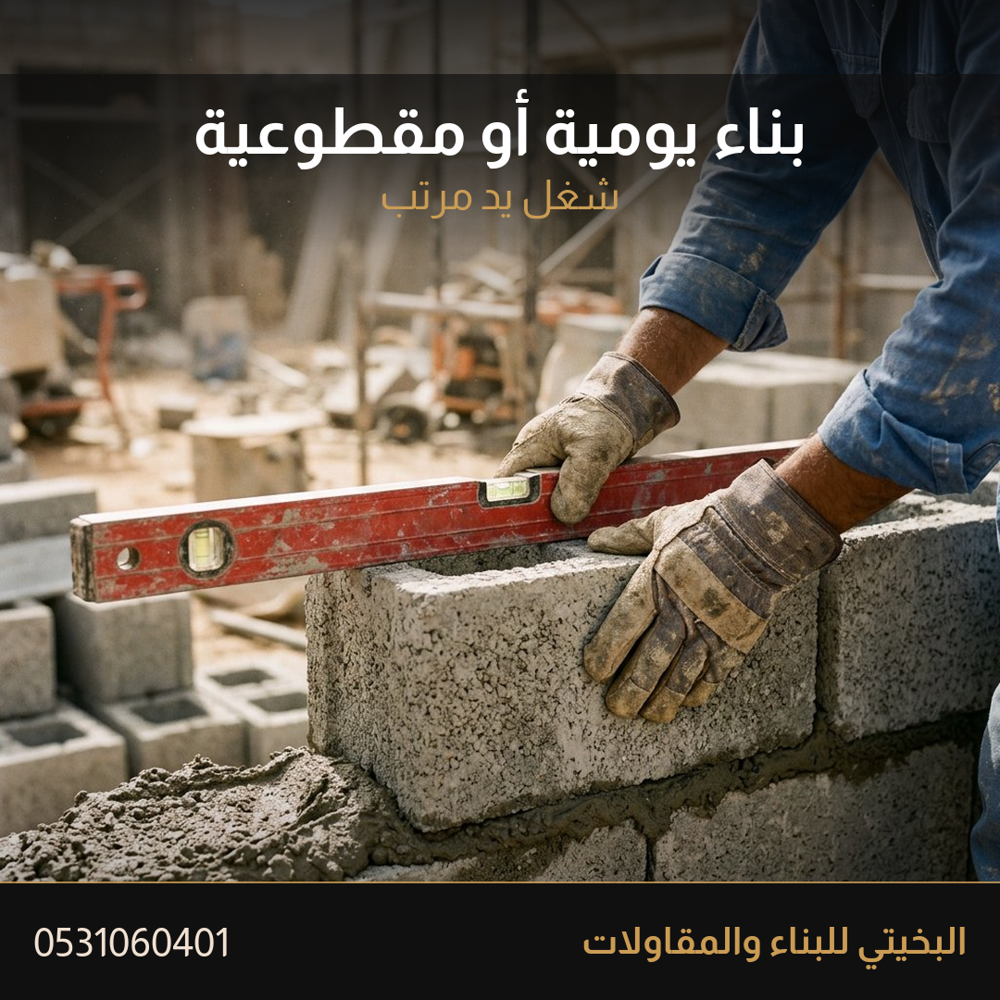
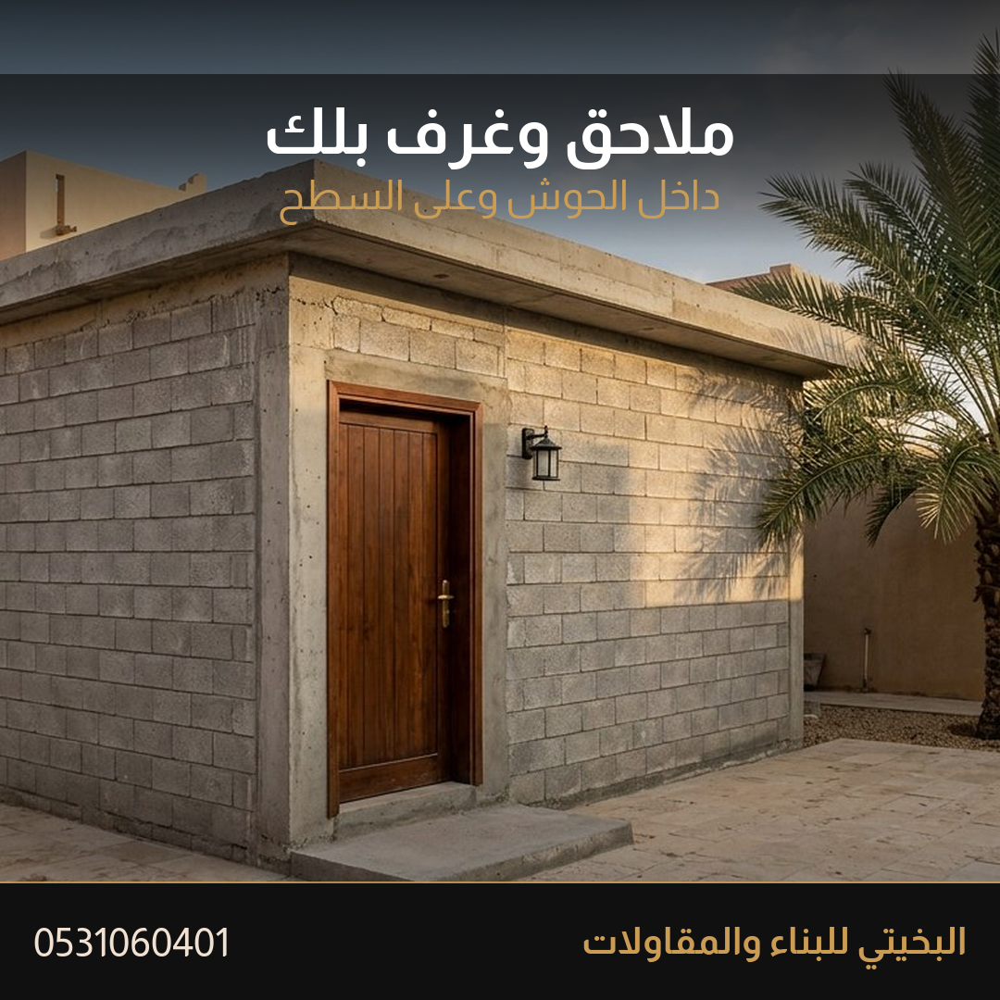
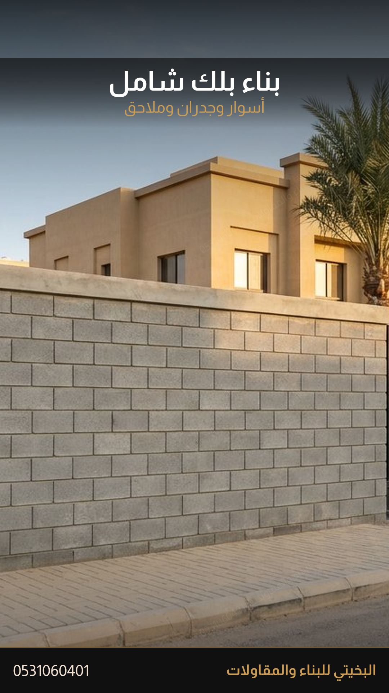

# إعلان بناء البلك الشامل

إعلان واحد يغطي شغل البلك كله: أسوار وجدران وملاحق وغرف وفواصل ومداخل وخزانات وحدود. لا يوجد إعلان ثانٍ للأسوار. هذا هو الإعلان الذي يُحدَّث كل ثلاثة أيام بدل نشر إعلان جديد.

> [!info] كيف تنشره
> إعلان جديد في خدمات، الرياض، إن لم يكن منشوراً. الصورة الأولى `صور/01-السور.png`. التعليقات مفتوحة. إذا كان الإعلان القديم منشوراً فحدّثه بهذا النص وهذه الصور ولا تنشر إعلاناً موازياً.

> [!warning] لا يُنشر
> لا كلمة «عرض» ولا «خصم» ولا سعر. لا تنزل السعر إلى 15 ريال للمتر لمجاراة إعلانات حراج. لا تُحذف التعليقات ولا تُغلق.

## لماذا هذا الإعلان شامل

العملاء يبحثون عن «سور بلك» و«بناء بلك» و«ملحق بلك» بكلمات مختلفة، وحراج لا يسمح بإعلان منفصل لكل كلمة. فالإعلان الواحد يجمع الخدمات كلها في العنوان والوصف والوسوم، والصور تُظهر السور والجدار والملحق والفواصل. البحث في حراج أظهر أن أغلب النتائج مصانع بلك ومواد بناء، لا مقاولي تركيب، وأن إعلانات الأسوار المفردة قليلة وضعيفة.

## العنوان

```
بناء بلك شامل في الرياض أسوار وجدران وملاحق وغرف البخيتي
```

56 حرفاً. فيه الكلمة الأساسية، وكلمة شامل، والمدينة، والخدمات، والعلامة.

## الوصف — انسخه كما هو

```
البخيتي للبناء والمقاولات
أشتغل بناء بلك في الرياض
أسوار وجدران وملاحق وغرف
فواصل ومداخل وخزانات وحدود
بلك 10 و15 و20 حسب شغلك
يومية أو مقطوعية على راحتك
في اليومية نتفق على أجرة اليوم والمواد منك إلا إذا اتفقنا غير كذا
في المقطوعية أقولك سعر الشغلة قبل ما أبدأ
أرسل نوع البلك والطول والارتفاع وصورة المكان
إذا اتفقنا أمشي على كلامنا
الأهم الثقة والأمانة
0531060401
الرياض
```

13 سطراً. بلا ترقيم وبلا كلمة ممنوعة.

## كلمات آخر الإعلان

```
بناء بلك الرياض، بناء بلوك، معلم بلك، مقاول بلك، أسوار بلك، جدران بلك، فواصل بلك، ملاحق بلك، غرف بلك، خزانات بلك، يومية بلك، مقطوعية بلك، البخيتي للبناء والمقاولات
```

12 كلمة. لا تتجاوزها.

## وصف الصفحة

```
بناء بلك في الرياض أسوار وجدران وملاحق وغرف وفواصل تنفيذ البخيتي للبناء والمقاولات يومية أو مقطوعية والسعر على شغل مكانك بعد صورة المكان
```

136 حرفاً.

## ترتيب الرفع

| الترتيب | الملف | لماذا |
|---|---|---|
| 1 | `صور/01-السور.png` | الغلاف. سور بلك كامل مع بوابة يشرح «شامل» في ثانية |
| 2 | `صور/02-الجدار.png` | جدار خارجي بخط مستقيم |
| 3 | `صور/03-البناء.png` | اليد والميزان. تُظهر الإتقان لا الشكل فقط |
| 4 | `صور/04-الفواصل.png` | فاصل داخلي وغرفة |
| 5 | `صور/05-الملحق.png` | ملحق بلك كامل بباب |
| 6 | `صور/06-التفصيلة.png` | الفاصل من قرب |
| 7 | `صور/07-اليومية-والمقطوعية.png` | بطاقة الفرق بين اليومية والمقطوعية |
| 8 | `صور/08-ستوري.png` | حالة واتساب، ليست صورة الإعلان |

## الرد داخل حراج

```
السلام عليكم
أشتغل بناء بلك في الرياض
أسوار وجدران وملاحق وفواصل
يومية أو مقطوعية
أرسل نوع البلك والطول والارتفاع وصورة المكان
0531060401
```

## أول رد واتساب

```
أهلا
عشان السعر يكون على شغلك
يومية أو مقطوعية
بلك 10 أو 15 أو 20
الطول والارتفاع
صورة المكان واللوكيشن
المواد في اليومية منك إلا إذا اتفقنا غير كذا
```

## ما لا يدخل هذا الإعلان

- لا سعر ولا مدة.
- لا فلل ولا عمائر كاملة. الشغل الهندسي المرخص أو الإشراف على مبنى كامل يُوجَّه لمقاول مرخص، ولا يُعلن هنا.
- لا صور من إعلان المشبات أو الأفران أو الحجر.
- شروط الدفع تبقى على الخاص.
- لا اسم حي ولا اسم عميل.

## الصور

### 1 — الغلاف



`صور/01-السور.png`

### 2 — جدار خارجي


`صور/02-الجدار.png`

### 3 — البناء بالميزان



`صور/03-البناء.png`

### 4 — فواصل وغرف


`صور/04-الفواصل.png`

### 5 — ملحق بلك



`صور/05-الملحق.png`

### 6 — تفصيلة الفاصل


`صور/06-التفصيلة.png`

### 7 — يومية أو مقطوعية


`صور/07-اليومية-والمقطوعية.png`

### 8 — ستوري واتساب



`صور/08-ستوري.png`

## سجل التحديث

- 2026-10-18: أُعيد بناء الصور الثماني، واتسع النص ليشمل الأسوار والملاحق والخزانات والحدود، والصورة الأولى صارت سوراً كاملاً ببوابة. الصور السابقة في `صور/سابقة`.
- 2026-10-04: النسخة الأولى.
