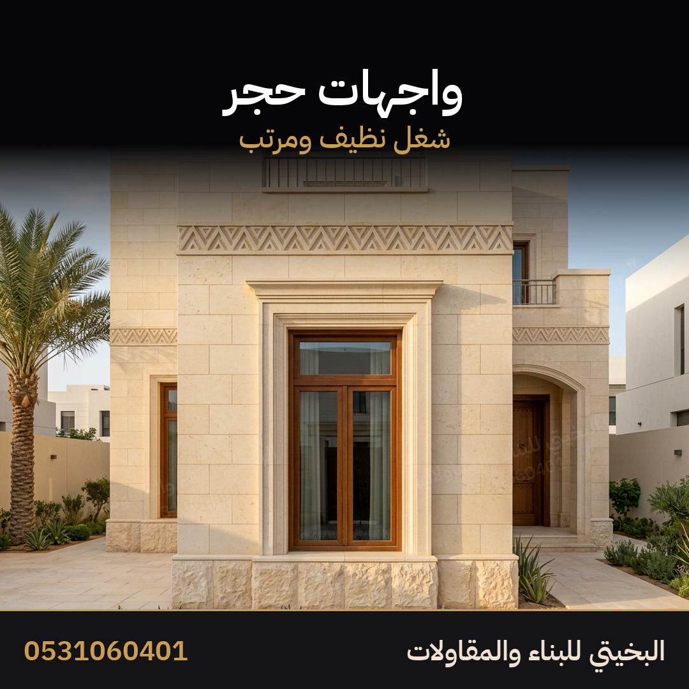
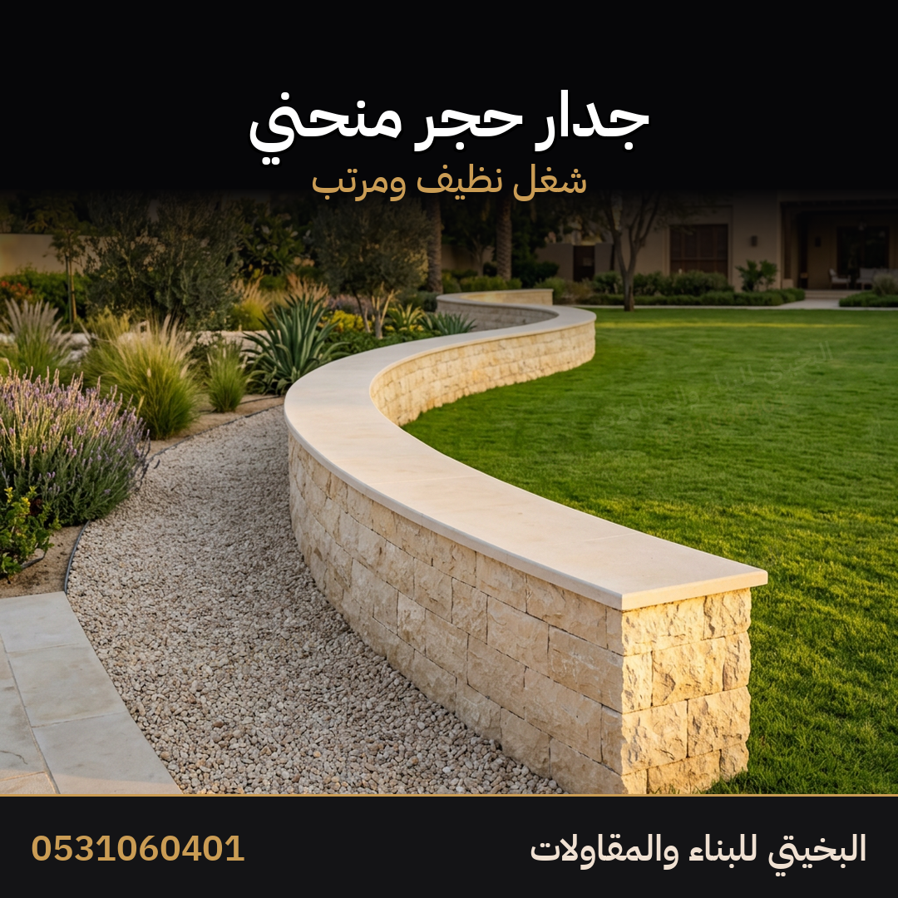
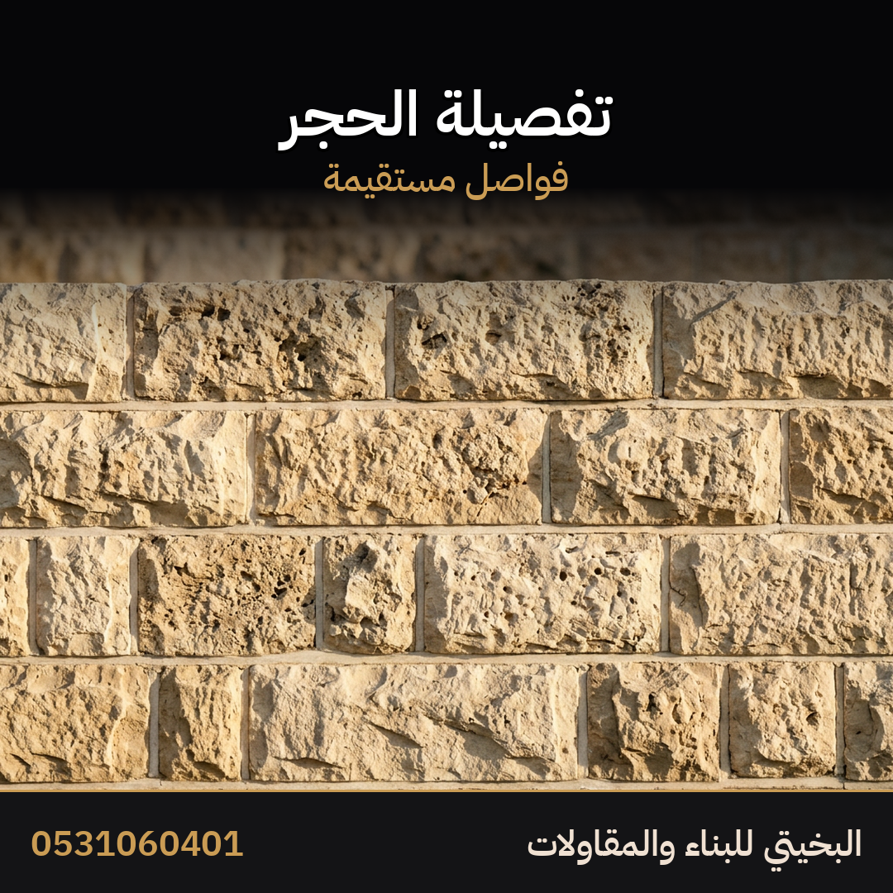
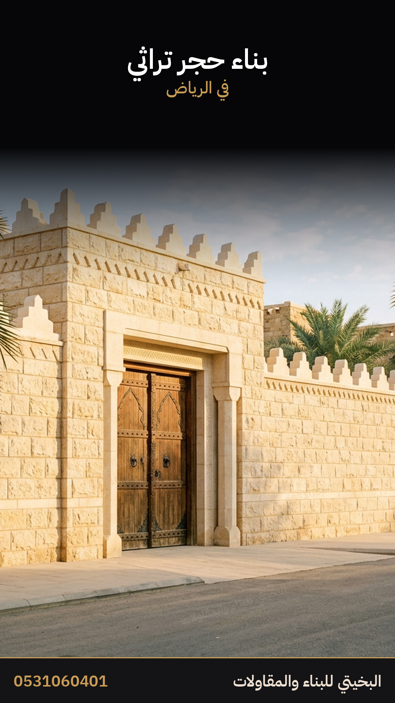

# إعلان الحجر التراثي

هذا الملف وحده يكفي لنشر إعلان الحجر. الصور في المجلد `صور` بجانبه، ولا تُستخدم في إعلان المشبات أو الأفران أو البلك.

الصور `06` و`07` و`09` شغل حقيقي من موقع العمل. والباقي صور تعريف بالخدمة.

> [!info] كيف تنشره
> إعلان جديد في خدمات، الرياض. الصورة الأولى `صور/01-الواجهة.png`. التعليقات مفتوحة. لا تحذفه وتدمجه مع إعلان البلك.

> [!warning] لا يُنشر
> لا تكتب مشبات ولا أفران ولا بلك في هذا الإعلان. لا تكتب اسم حي. لا تكتب سعراً في الوصف. لا تكتب كلمة من قائمة المنع. السعر يُكتب بعد صورة المكان.

## العنوان

```
بناء حجر تراثي في الرياض جدران وواجهات وأسوار وبوابات
```

## الوصف — انسخه كما هو

```
أبو محمد معلم مباني
أشتغل حجر تراثي في الرياض
جدران وواجهات وأسوار وبوابات وجدران منحنية
حجر طبيعي وتنفيذ نظيف ومرتب
تبغى جدار حجر أو واجهة أو سور أرسل صورة المكان والمقاس
الرياض وعند الطلب الخرج والمزاحمية والدرعية ورماح والحوطة
أقولك السعر على مكانك وإذا اتفقنا أمشي على كلامنا
الأهم الثقة والأمانة
0531060401
الرياض
```

المدينة في السطر الثاني والسطر قبل الأخير، والكلمة الأساسية في سطرين بصور طبيعية بلا حشو.

## وصف قصير للمنصات

للحالة ومنصة التغريد حين المساحة ضيقة:

```
أبو محمد معلم مباني
حجر تراثي في الرياض
جدران وواجهات وأسوار وبوابات
أرسل صورة المكان والمقاس
0531060401
```

## الوسوم

تُستخدم في المنصة التي تدعم الوسوم. لا تُستخدم في حراج لأن حراج لا يفهرسها.

```
#حجر_تراثي #حجر_الرياض #واجهات_حجر #اسوار_حجر #بوابات_حجر #جدران_حجر #جدار_منحني #حجر_طبيعي #معلم_حجر #مقاول_الرياض #الرياض #أبو_محمد_معلم_مباني
```

اثنا عشر وسماً. لو المنصة تحد العدد، تُقدَّم الخمسة الأولى.

## الكلمات المفتاحية

للاستخدام في وصف الصفحة وفي وصف الإعلان وفي نص آخر الإعلان:

```
حجر تراثي الرياض، بناء حجر، واجهات حجر، أسوار حجر، بوابات حجر، جدران حجر، جدار منحني، حجر طبيعي، معلم حجر، حجر تراثي، معلم مباني الرياض، أبو محمد معلم مباني
```

## وصف الإعلان لمحركات البحث

سطر واحد يدخل في وصف الصفحة وفي بطاقة الرابط، من 120 إلى 155 حرفاً:

```
حجر تراثي في الرياض. جدران وواجهات وأسوار وبوابات وجدران منحنية. حجر طبيعي وتنفيذ نظيف. أرسل صورة المكان والمقاس. 0531060401
```

القواعد الكاملة في `العمليات/تحسين-محركات-البحث.md` وتُراجَع قبل أي نشر.

## كلمات آخر الإعلان

```
بناء حجر تراثي، حجر الرياض، واجهات حجر، أسوار حجر، بوابات حجر، جدران حجر، جدار منحني، حجر طبيعي، حجر تراثي، معلم حجر الرياض، أبو محمد معلم مباني
```

## ترتيب الرفع

| الترتيب | الملف | لماذا هذا الترتيب |
|---|---|---|
| 1 | `صور/01-الواجهة.png` | غلاف الإعلان. سور وبوابة حجر نظيفة |
| 2 | `صور/02-الواجهات.png` | واجهة فيلا بحجر نظيف |
| 3 | `صور/03-البوابات.png` | بوابة على الطراز النجدي |
| 4 | `صور/04-الجدار-المنحني.png` | الجدار المنحني شغل مرتب |
| 5 | `صور/05-التفصيلة.png` | تفصيلة الحجر والفواصل |
| 6 | `صور/06-شغل-حقيقي.png` | من شغلنا على الطبيعة |
| 7 | `صور/07-شغل-حقيقي-واسع.jpg` | نفس العمل بصورة أوسع |
| 8 | `صور/08-الأعمال.png` | الاسم والخدمات والرقم |
| حالة | `صور/09-ستوري-شغل-حقيقي.png` | حالة واتساب، شغل حقيقي |
| حالة | `صور/10-ستوري.png` | حالة واتساب، تعريف بالخدمة |

## الرد داخل حراج

```
السلام عليكم
أشتغل حجر تراثي في الرياض
جدران وواجهات وأسوار وبوابات وجدران منحنية
أرسل صورة المكان والمقاس
أقولك السعر وإذا اتفقنا أمشي على كلامنا
0531060401
```

## أول رد واتساب

```
أهلا
عشان السعر يكون على شغلك
جدار أو واجهة أو سور أو بوابة أو جدار منحني
الطول والارتفاع
صورة المكان واللوكيشن
إذا اتفقنا أمشي على كلامنا
```

## ملاحظات على الصور

- الصورة `06` و`07` و`09` من شغل حقيقي في الموقع، نُظّفت بلا تغيير في الشغل نفسه.
- العلامة المائية داخلة في البكسلات. الرقم بلا مسافات.
- لا تُعد تلوين الصور الحقيقية، ولا تحذف العلامة، ولا تقص الزاوية.

## ما لا يدخل هذا الإعلان

- لا فلل ولا عمائر في الوصف.
- لا مشبات ولا أفران ولا بلك.
- شروط الدفع تبقى على الخاص، وليست في الصورة ولا في الوصف.
- لا صورة من إعلان المشبات أو الأفران أو البلك.

## غلاف المتجر

ليس من صور هذا الإعلان. ارفعه من `المتجر/غلاف.png`.

## الصور

### 1 — غلاف الإعلان


`صور/01-الواجهة.png`

### 2 — واجهات



`صور/02-الواجهات.png`

### 3 — بوابات


`صور/03-البوابات.png`

### 4 — جدار منحني



`صور/04-الجدار-المنحني.png`

### 5 — تفصيلة الحجر



`صور/05-التفصيلة.png`

### 6 — شغل حقيقي


`صور/06-شغل-حقيقي.png`

### 7 — شغل حقيقي واسع


`صور/07-شغل-حقيقي-واسع.jpg`

### 8 — الأعمال


`صور/08-الأعمال.png`

### حالة واتساب — الشغل


`صور/09-ستوري-شغل-حقيقي.png`

### حالة واتساب — الخدمة



`صور/10-ستوري.png`
