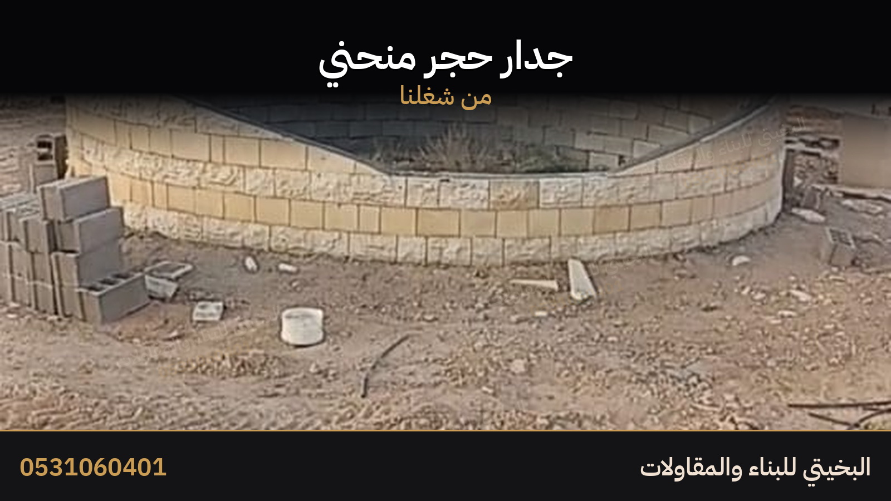
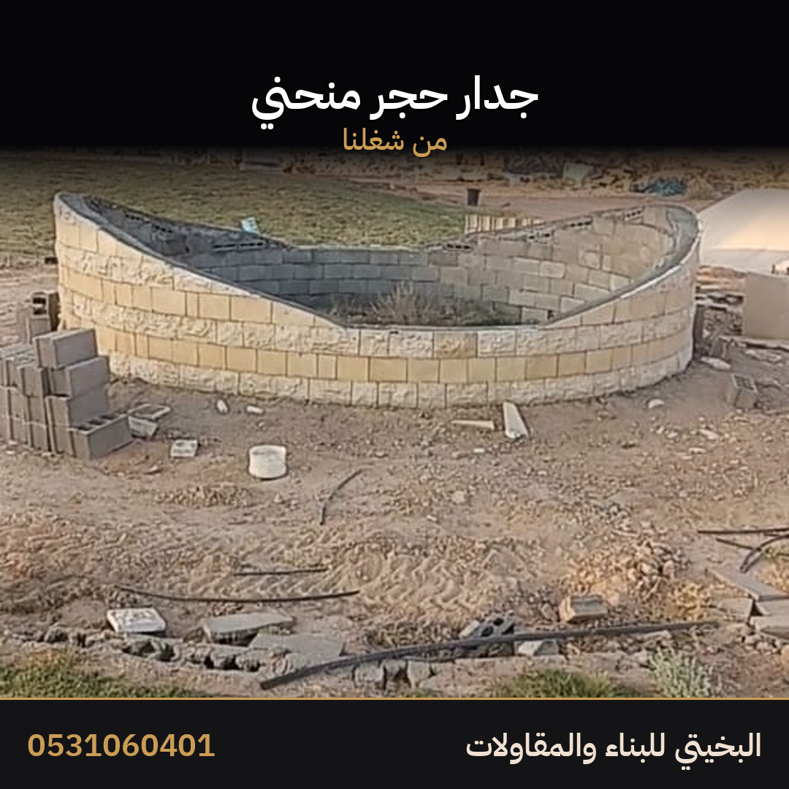
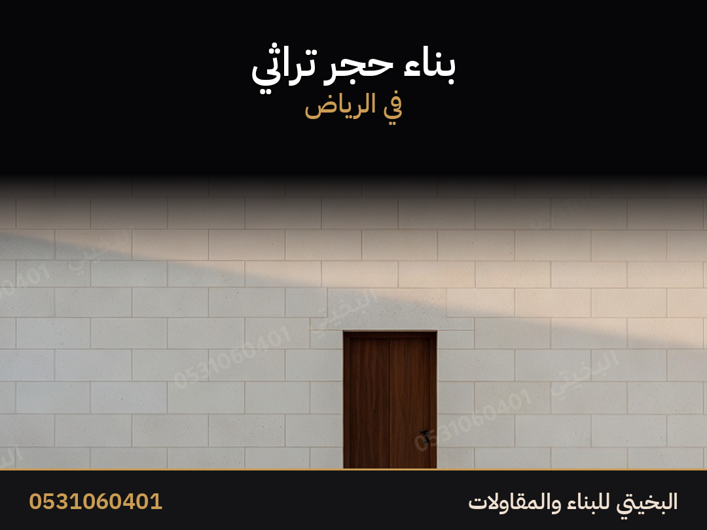
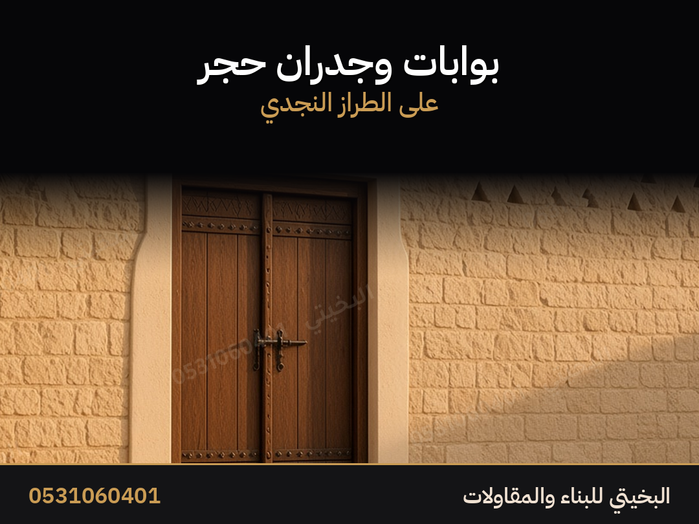
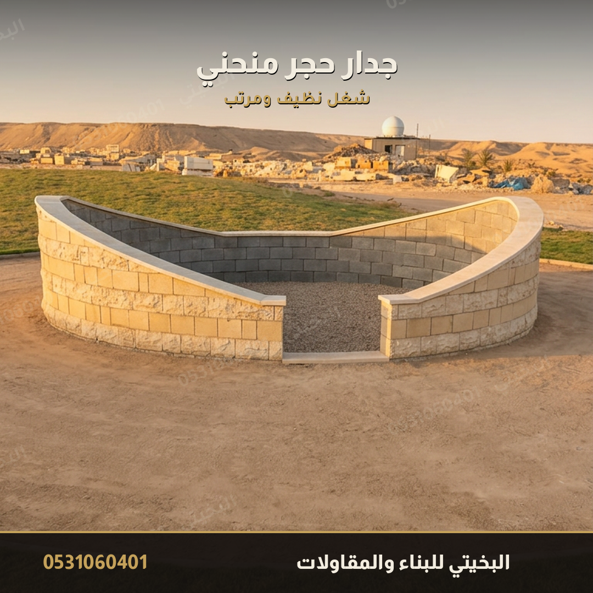
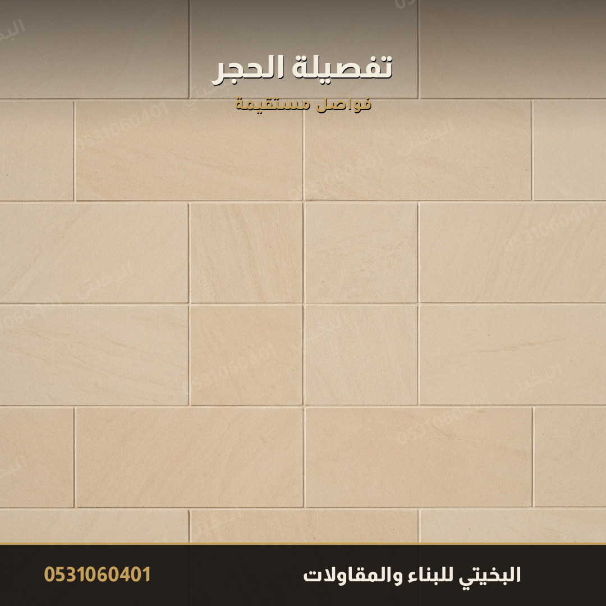
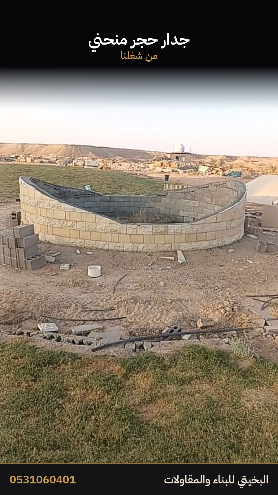
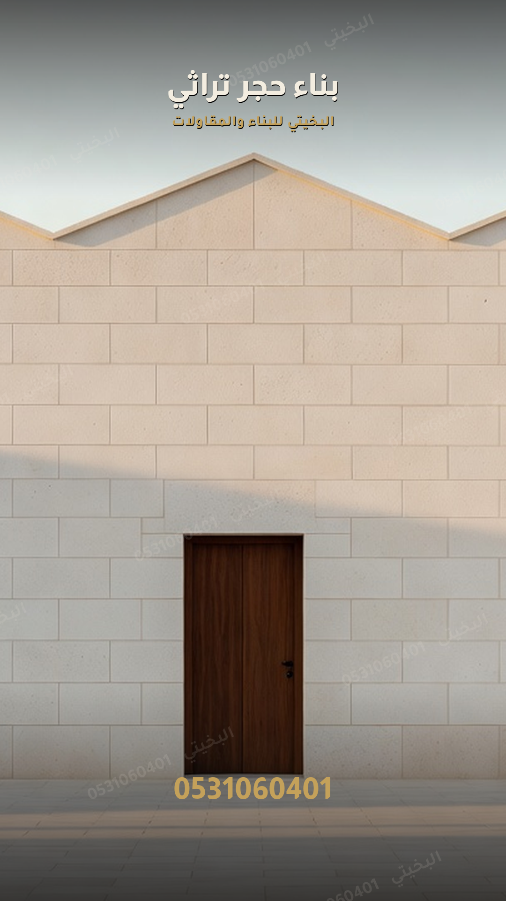

# إعلان الحجر التراثي

هذا الملف وحده يكفي لنشر إعلان الحجر. صوره في المجلد `صور` بجانبه. لا تُخلط مع إعلان المشبات أو الأفران أو البلك.

فيه صورتان حقيقيتان من شغل اليد على الطبيعة، والباقي صور تعريف بالخدمة.

> [!info] كيف تنشره
> إعلان جديد في خدمات، قسم المقاولات، الرياض. صورة الغلاف `صور/08-شغل-حقيقي-واسع.jpg` لأنها شغل حقيقي وتُقرأ من بعيد. التعليقات مفتوحة. غلاف المتجر منفصل، وليس صورة هذا الإعلان.

> [!warning] لا يُنشر
> لا تكتب مشبات ولا أفران ولا بلك في هذا الإعلان. لا تكتب اسم حي. لا تكتب سعراً في الوصف. لا تكتب كلمة من قائمة المنع. السعر بعد صورة المكان.

## العنوان

الأساسي:

```
حجر تراثي في الرياض جدران وواجهات وأسوار وجدران منحنية
```

بديل أول:

```
معلم حجر تراثي في الرياض جدران وواجهات وأسوار
```

بديل ثانٍ:

```
بناء حجر تراثي في الرياض البخيتي للبناء والمقاولات
```

اختر واحداً فقط. لا تجمع أكثر من عنوان.

## الوصف — انسخه كما هو

```
البخيتي للبناء والمقاولات
أشتغل حجر تراثي في الرياض
جدران وواجهات وأسوار وجدران منحنية
من شغلي اللي تشوفه في الصور
أرسل صورة المكان والمقاس وأقولك السعر
إذا اتفقنا أمشي على كلامنا
الأهم الثقة والأمانة
0531060401
الرياض
```

بلا ترقيم وبلا تنصيص وبلا إيموجي. السطر الجديد يكفي.

## كلمات آخر الإعلان

```
بناء حجر تراثي، حجر الرياض، واجهات حجر، أسوار حجر، جدران حجر، جدار منحني، حجر طبيعي، حجر تراثي، معلم حجر الرياض، البخيتي للبناء والمقاولات
```

## ترتيب رفع الصور

ارفعها بهذا الترتيب. الأولى هي غلاف الإعلان.

| الترتيب | الملف | لماذا هذا الترتيب |
|---|---|---|
| 1 | `صور/08-شغل-حقيقي-واسع.jpg` | شغل حقيقي، 1600×900، تُقرأ من بعيد وهي صورة الغلاف |
| 2 | `صور/07-جدار-حقيقي-منحني.png` | نفس العمل من زاوية ثانية، 1080×1080 |
| 3 | `صور/01-الواجهة.png` | واجهة حجر نظيفة، 1080×810 |
| 4 | `صور/03-البوابة.png` | باب وجدران على الطراز النجدي، 1080×810 |
| 5 | `صور/02-الجدار-المنحني.png` | الجدار المنحني كامل، 1080×1080 |
| 6 | `صور/04-التفصيلة.png` | تفصيلة الحجر والفواصل، 1080×1080 |
| 7 | `صور/05-الأعمال.png` | الاسم والخدمات والرقم، 1080×1080 |
| حالة واتساب | `صور/09-ستوري-شغل-حقيقي.png` | 1080×1920، شغل حقيقي |
| حالة واتساب ثانية | `صور/06-ستوري.png` | 1080×1920، تعريف بالخدمة |

## الرد داخل حراج

```
السلام عليكم
أشتغل حجر تراثي في الرياض
جدران وواجهات وأسوار وجدران منحنية
أرسل صورة المكان والمقاس
أقولك السعر وإذا اتفقنا أمشي على كلامنا
0531060401
```

## أول رد واتساب

```
أهلا
عشان السعر يكون على شغلك
جدار أو واجهة أو سور أو جدار منحني
الطول والارتفاع
صورة المكان واللوكيشن
إذا اتفقنا أمشي على كلامنا
```

## ملاحظات على الصور

- الصور الحقيقية نظّفت ووُضّحت بلا تغيير في الشغل نفسه. أشرطة الواتساب انزالت، والقياس ثابت.
- العلامة المائية داخلة في البكسلات: الاسم والرقم، وشريط أسفل كل صورة.
- الرقم بلا مسافات في كل الصور.
- لا تُعد تلوين الصور الحقيقية، ولا تحذف العلامة، ولا تقص الزاوية.

## غلاف المتجر

ليس من صور هذا الإعلان. ارفعه من `المتجر/غلاف.png`.

## الصور

### غلاف الإعلان — 1



### 2 — العمل من زاوية ثانية



### 3 — الواجهة



### 4 — البوابة



### 5 — الجدار المنحني



### 6 — التفصيلة



### 7 — الأعمال


### حالة واتساب — العمل



### حالة واتساب — الخدمة


